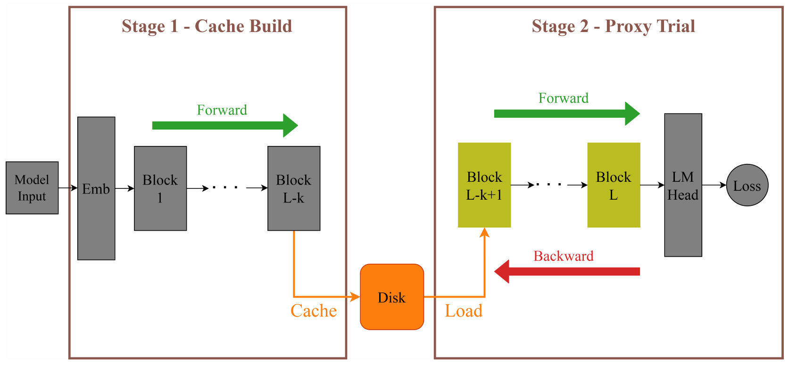
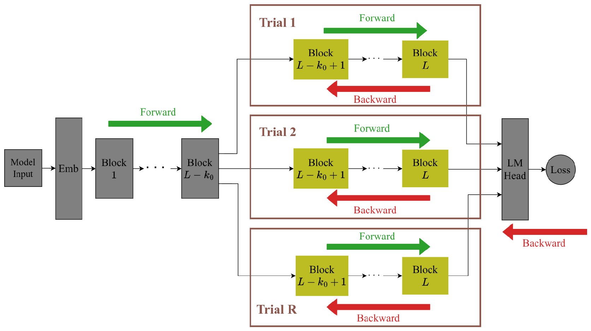

# Learning Rate Search Prototypes

This folder contains two prototypes of the TipSweep learning rate search. Both finetune DeepSeek-Coder-6.7B-Base on Magicoder-OSS-Instruct-75K. During the search, they train only the last transformer block ($k_0 = 1$) and keep the other 31 blocks frozen. These frozen blocks form the *frozen prefix*, which runs forward only. The two prototypes differ in where they keep the output of the frozen prefix.

- The **two-stage prototype** stores the prefix output on disk. A *cache build* runs once, and each *cached proxy trial* then trains the last block at one candidate learning rate. The search fits on a consumer GPU with about 16 GiB of memory.
- The **cache-free prototype** keeps the prefix output of the current batch in GPU memory. It trains one copy of the last block for each candidate learning rate, so a single pass over the dataset completes every proxy trial. Its memory grows with the number of candidates, so it suits a high-end GPU.

| | Two-stage prototype | Cache-free prototype |
| :--- | :--- | :--- |
| Scripts | [run-prototype-s1.py](run-prototype-s1.py) (cache build)<br>[run-prototype-s2.py](run-prototype-s2.py) (cached proxy trial) | [run-cache-free-prototype.py](run-cache-free-prototype.py) |
| Prefix output | Stored on disk (336.8 GiB) | Kept in GPU memory, one batch at a time |
| Passes over the data | One for the cache build, then one per candidate | One for all candidates |
| GPU memory | Fits in about 16 GiB | Grows by 1.51 GiB (BF16) or 3.02 GiB (FP32) per candidate |
| GPU in the paper | 1× RTX 5060 Ti (15.45 GiB available) | 1× H200 (140 GiB) |

Section 5.4 and Appendices E and F of the paper describe both prototypes and their results.

## Before you start

Run every command from the repository root, and launch the scripts as modules with `python -m`:

```bash
python -m prototypes.run-cache-free-prototype --help
```

The scripts import the shared [utils/](../utils/) package and read [auxiliary_data/](../auxiliary_data/) relative to the repository root. If you run a script by its file path instead, such as `python prototypes/run-prototype-s1.py`, Python cannot find `utils` and stops with a `ModuleNotFoundError`.

Install the packages in [requirements.txt](../requirements.txt) as described in the main [README](../README.md#setup). The scripts load the model and the dataset from Hugging Face. They use FlashAttention 2 by default, and `--attn-impl eager` switches to the eager attention of Transformers. The cache-free prototype also uses Liger Kernel, which computes the LM head and the cross-entropy loss together without storing the full logits.

The scripts accept these common arguments:

| Argument | Meaning |
| :--- | :--- |
| `--output-layer` | Number of frozen blocks, $L - k_0$. DeepSeek-Coder-6.7B has $L = 32$ blocks, so the default `31` trains only the last block. Use the same value in both stages of the two-stage prototype. |
| `--precision` | `bf16` for direct BF16 updates, or `fp32` for FP32 master weights with BF16 autocast. It applies to the trainable blocks only, as the frozen prefix always runs in BF16. Stage 1 does not train, so it has no such argument. |
| `--batch-size`, `--grad-accum` | Per-GPU batch size and number of gradient accumulation steps. Their product is the effective batch size, which is 32 in the paper. Stage 1 takes only `--batch-size`. |
| `--filter-length` | Removes the 2,999 examples listed in [auxiliary_data/](../auxiliary_data/) and keeps the 72,198 training examples used in the paper. Use it with Stage 1 and with the cache-free prototype, which read the raw dataset. Stage 2 trains on whatever the cache contains. |
| `--logging-steps` | Number of optimizer steps between log lines. The default is 10. Stage 2 and the cache-free prototype only. |

Stage 2 and the cache-free prototype print their progress to standard output. Each log line shows the training loss smoothed with an exponential moving average (EMA), as in the paper. Stage 2 also shows the current learning rate. The cache-free prototype shows one EMA loss per candidate, together with `lr scale`, the factor that the warmup and cosine schedule applies to every candidate's learning rate. When training ends, both scripts report the training time, the peak allocated GPU memory, and the final EMA loss. Neither script saves checkpoints.

## Two-stage prototype

<p align="center">
  
</p>

*Two-stage prototype (Figure 29 of the paper). Stage 1 (cache build) runs the frozen prefix forward once and stores the output of block $L - k_0$ on disk. Stage 2 (cached proxy trial) loads these features and trains blocks $L - k_0 + 1$ through $L$ at one candidate learning rate. The LM head stays frozen, but gradients pass through it to the trainable blocks.*

### Stage 1: build the feature cache

The cache build passes the training set through the frozen prefix once, in inference mode. It stores the output of block $L - k_0$ for every example on disk in BF16.

```bash
python -m prototypes.run-prototype-s1 \
  --output-layer 31 \
  --batch-size 1 \
  --filter-length \
  --save-root checkpoints
```

The features are written to:

```text
checkpoints/deepseek-coder-6.7b-base/Magicoder-OSS-Instruct-75K/FT-O31/feature_cache/
```

The cache takes 336.8 GiB of disk space. Before writing new features, Stage 1 deletes the existing `batch_*.safetensors` files in this folder. Other files are left untouched.

### Stage 2: run one cached proxy trial per candidate

Each Stage 2 run loads the cache, trains the last block at one learning rate, and makes one pass over the cached dataset. `--learning-rate-exponent a` sets the learning rate to $2^{-a}$, so run the command once for each candidate in your grid. Set `--cache-root` to the `--save-root` of Stage 1. Both precisions read the same cache, so the cache build runs only once.

```bash
# Direct BF16 updates
python -m prototypes.run-prototype-s2 \
  --output-layer 31 --precision bf16 \
  --batch-size 1 --grad-accum 32 \
  --learning-rate-exponent 11.5 \
  --cache-root checkpoints

# FP32 master weights, with BF16 autocast
python -m prototypes.run-prototype-s2 \
  --output-layer 31 --precision fp32 \
  --batch-size 2 --grad-accum 16 \
  --learning-rate-exponent 12 \
  --cache-root checkpoints
```

Both examples use an effective batch size of 32 and the learning rates selected in the paper's case study. Their batch settings were the fastest on the RTX 5060 Ti (Table 12 of the paper).

## Cache-free prototype

The cache-free prototype loads the full model once and makes $R$ copies of the last $k_0$ blocks, one for each candidate learning rate. Each copy has its own gradients and AdamW states. For each batch, the frozen prefix runs once, and the $R$ copies then run forward and backward on its output, one after another. A single run therefore trains every candidate on the same batches in the same order.

<p align="center">
  
</p>

*Cache-free prototype (Figure 30 of the paper). The frozen prefix processes each batch once and passes the output of block $L - k_0$ directly to all $R$ trials. Each trial trains its own copy of blocks $L - k_0 + 1$ through $L$ at a different candidate learning rate. All trials share the frozen LM head, and gradients pass through it to each copy.*

`--candidate-exponents` sets the grid: each value $a$ adds the candidate learning rate $2^{-a}$. The examples below search five candidates around the rates selected in the paper.

```bash
# Direct BF16 updates
python -m prototypes.run-cache-free-prototype \
  --output-layer 31 --precision bf16 \
  --batch-size 16 --grad-accum 2 \
  --candidate-exponents 10.5 11 11.5 12 12.5 \
  --filter-length

# FP32 master weights, with BF16 autocast
python -m prototypes.run-cache-free-prototype \
  --output-layer 31 --precision fp32 \
  --batch-size 16 --grad-accum 2 \
  --candidate-exponents 11 11.5 12 12.5 13 \
  --filter-length
```

Any split of `--batch-size` and `--grad-accum` whose product is 32 matches the effective batch size of the paper. The fastest split depends on the GPU.

Because the copies run one at a time, the GPU holds the activations of only one copy. Each additional candidate adds the weights, gradients, and two AdamW moment estimates of one block. Peak memory is therefore about $M_0 + 1.51R$ GiB under BF16 and $M_0 + 3.02R$ GiB under FP32. Here $M_0$ covers the frozen weights and the activations of the prefix and one copy. With every sequence at 1,024 tokens, $M_0$ grows from 12.3 GiB at a per-GPU batch size of 1 to 28.3 GiB (BF16) or 29.8 GiB (FP32) at a batch size of 64. On a 140 GiB H200 at a batch size of 64, the paper fits 40 candidates under BF16 (88.6 GiB peak) and up to 35 under FP32.

## Select and transfer the learning rate

Select the candidate with the lowest final EMA loss, $\hat\eta_{k_0}$. The scripts compute the EMA as in the paper, $\bar\ell_t = 0.1\,\ell_t + 0.9\,\bar\ell_{t-1}$, where $\ell_t$ is the training loss at optimizer step $t$. Each Stage 2 run ends with the final EMA loss of its candidate, so compare the last lines of your Stage 2 runs. The cache-free prototype ends with the final EMA loss of every candidate and marks the lowest one with `(best)`.

Then scale the selected rate to $k$ trainable blocks with the rule for your update precision:

| Update precision | Learning rate for $k$ blocks | Change in `--learning-rate-exponent` |
| :--- | :--- | :--- |
| FP32 master weights | $\eta_k = \hat\eta_{k_0}\,(k_0/k)$ | Add $\log_2(k/k_0)$ |
| Direct BF16 | $\eta_k = \hat\eta_{k_0}\,\sqrt{k_0/k}$ | Add $\tfrac{1}{2}\log_2(k/k_0)$ |

## Memory and runtime in the paper

The tables below report one epoch at an effective batch size of 32, with a maximum sequence length of 1,024 tokens. Your numbers will depend on the hardware, the attention backend, and the batch configuration.

**Two-stage prototype on one RTX 5060 Ti** (Table 11 of the paper):

| | Direct BF16 | FP32 master weights |
| :--- | ---: | ---: |
| Stage 1 batch size | 1 | 1 |
| Stage 2 micro-batch × accumulation | 1 × 32 | 2 × 16 |
| Cache build (runs once) | 3.78 h | 3.78 h |
| One cached proxy trial | 0.58 h | 0.71 h |
| Cache build + 5 trials | 6.68 h | 7.34 h |
| Cache build + 10 trials | 9.58 h | 10.89 h |

The final full-depth run needs more memory than the RTX 5060 Ti provides, so it runs on a high-end GPU.

**Cache-free prototype on one H200** (Table 17 of the paper):

| Candidates $R$ | Search, direct BF16 | Search, FP32 master weights |
| ---: | ---: | ---: |
| 5 | 0.73 h | 0.76 h |
| 10 | 0.99 h | 1.03 h |
| 15 | 1.24 h | 1.30 h |
| 20 | 1.48 h | 1.57 h |

The search costs about half an hour for the forward pass through the frozen prefix, plus about 3 minutes for each candidate. For comparison, one full-depth run on one H200 takes 1.48 h under BF16 and 1.93 h under FP32. Counting the search and one full-depth run, the cache-free prototype uses about 3× fewer H200 hours than a full-depth sweep at $R = 5$ and about 10× fewer at $R = 20$.

## Scope

- Both prototypes need a fixed offline dataset, as in SFT and DPO. They do not apply to on-policy training such as RLVR, where each trial generates its own completions during training.
- The scripts support only DeepSeek-Coder-6.7B-Base on Magicoder-OSS-Instruct-75K.
